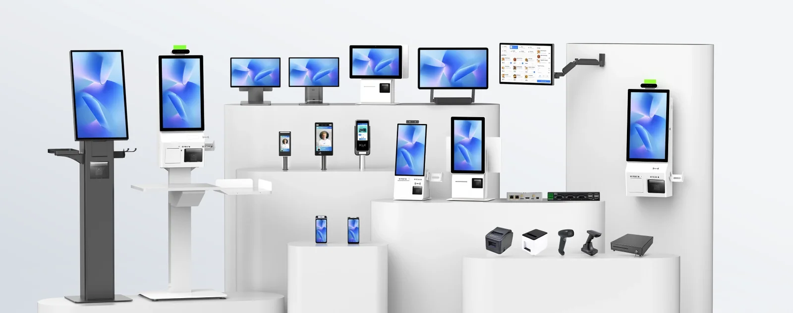

  <a href="https://www.suntekai.com">
    <picture>
      <source media="(prefers-color-scheme: dark)" srcset="./profile/assets/logo-dark.png">
      <source media="(prefers-color-scheme: light)" srcset="./profile/assets/logo-light.png">
      
    </picture>
  </a>

  <h1>SUNTEK Organization Profile &amp; Community Health Templates</h1>

  

    Organization-wide developer onboarding, issue templates, security disclosure policy, and machine-readable hardware catalog for <strong>SUNTEK Technology Co., Ltd.</strong>
  

  

    
    
    
  

  

---

## Organization Configuration Contents

| File | Purpose |
| :--- | :--- |
| [`profile/README.md`](./profile/README.md) | Official GitHub Organization homepage, visual product gallery, and per-model SDK lookup table |
| [`hardware-catalog.json`](./hardware-catalog.json) | Machine-readable mapping from commercial hardware models to SDK repositories |
| [`ISSUE_TEMPLATE/bug_report.yml`](./ISSUE_TEMPLATE/bug_report.yml) | Structured bug & technical support issue intake form |
| [`ISSUE_TEMPLATE/config.yml`](./ISSUE_TEMPLATE/config.yml) | Issue chooser external links to official portal & security advisory policy |
| [`SECURITY.md`](./SECURITY.md) | Private vulnerability disclosure policy (`support@suntekai.com`) |
| [`CODEOWNERS`](./CODEOWNERS) | Maintainer ownership mapping across SDKs and security policies |

---

  
    
  <strong>SUNTEK Technology Co., Ltd.</strong> &mdash; <em>Enjoy Smarter Service</em>

