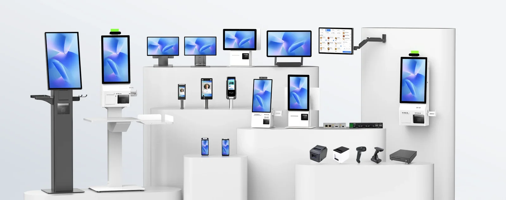
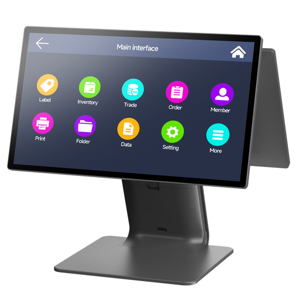
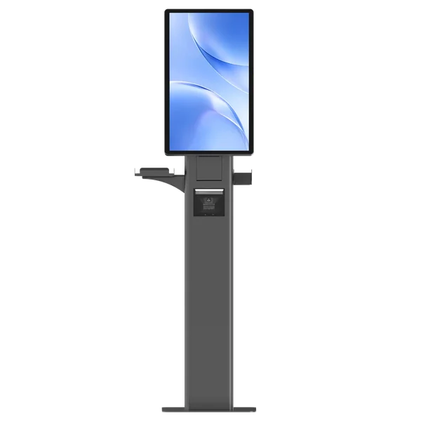
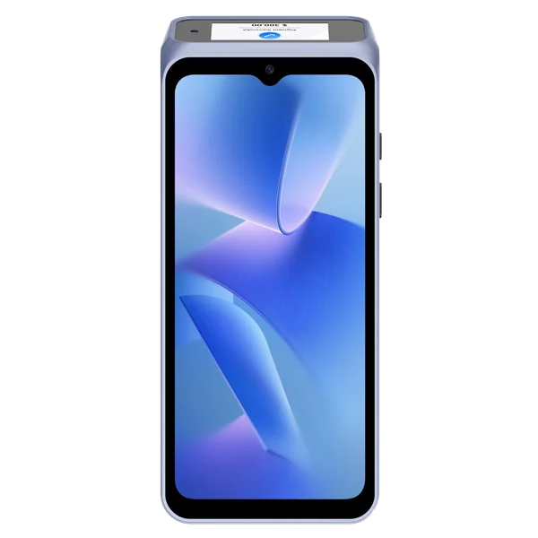
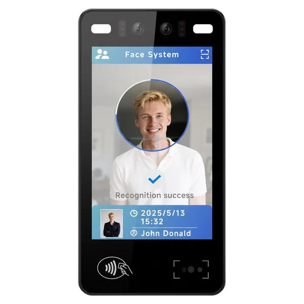
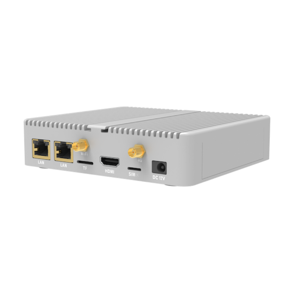
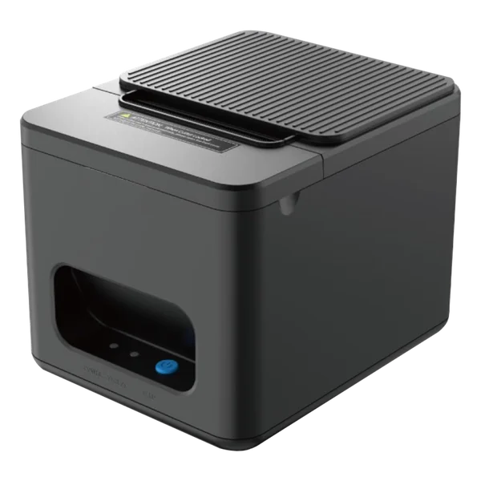
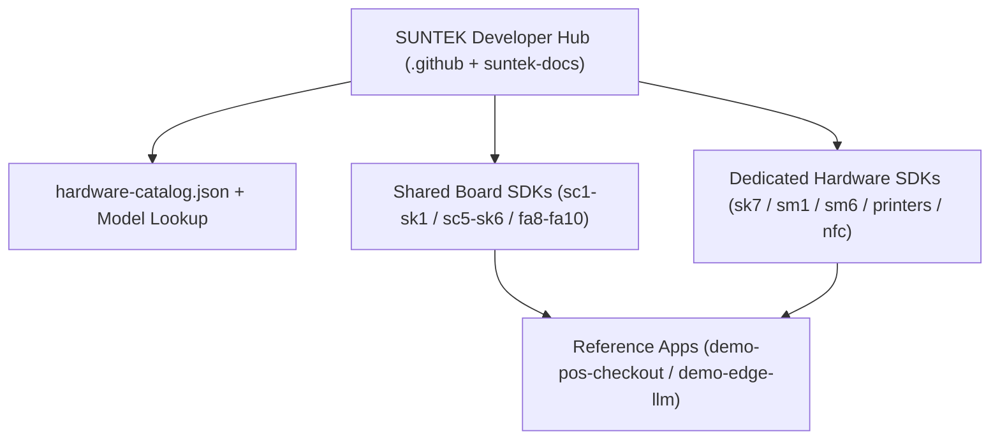

  <a href="https://www.suntekai.com">
    <picture>
      <source media="(prefers-color-scheme: dark)" srcset="https://raw.githubusercontent.com/SUNTEK-Official/.github/main/profile/assets/logo-dark.png">
      <source media="(prefers-color-scheme: light)" srcset="https://raw.githubusercontent.com/SUNTEK-Official/.github/main/profile/assets/logo-light.png">
      
    </picture>
  </a>

  <h1>SUNTEK Developer Hub</h1>

  

    <strong>Smart Commercial Terminal Hardware Manufacturer</strong> &middot; <em>Enjoy Smarter Service</em> 
    Official GitHub organization of <strong>SUNTEK Technology Co., Ltd.</strong> for global B2B hardware integrators, POS ISVs, and embedded engineers.
  

  

    
    
    
    
  

  

    <a href="#hardware-product-showcase">Product Showcase</a> &nbsp;&bull;&nbsp;
    <a href="#find-your-sdk-by-commercial-hardware-model">Model Lookup Matrix</a> &nbsp;&bull;&nbsp;
    <a href="#developer-ecosystem-architecture">Architecture</a> &nbsp;&bull;&nbsp;
    <a href="#supporting-repositories">Supporting Repos</a> &nbsp;&bull;&nbsp;
    <a href="#security--support">Support</a>
  

  

---

## Hardware Product Showcase

<table>
  <tr>
    <td align="center" width="33%">
       
      <strong>Desktop POS Terminals</strong> 
      <a href="https://github.com/SUNTEK-Official/suntek-sdk-sc1-sk1">SC1</a> &middot; <a href="https://github.com/SUNTEK-Official/suntek-sdk-sc5-sk6">SC5</a> &middot; <a href="https://github.com/SUNTEK-Official/suntek-sdk-st5">ST5</a>
    </td>
    <td align="center" width="33%">
       
      <strong>Self-Service Kiosks</strong> 
      <a href="https://github.com/SUNTEK-Official/suntek-sdk-sc1-sk1">SK1 / SK1-15</a> &middot; <a href="https://github.com/SUNTEK-Official/suntek-sdk-sk5-fingerprint">SK5</a> &middot; <a href="https://github.com/SUNTEK-Official/suntek-sdk-sc5-sk6">SK6</a> &middot; <a href="https://github.com/SUNTEK-Official/suntek-sdk-sk7">SK7</a>
    </td>
    <td align="center" width="33%">
       
      <strong>Handheld Smart POS</strong> 
      <a href="https://github.com/SUNTEK-Official/suntek-sdk-sm1">SM1</a> &middot; <a href="https://github.com/SUNTEK-Official/suntek-sdk-sm6">SM6</a>
    </td>
  </tr>
  <tr>
    <td align="center" width="33%">
       
      <strong>Biometric Access Terminals</strong> 
      <a href="https://github.com/SUNTEK-Official/suntek-sdk-fa5">FA5</a> &middot; <a href="https://github.com/SUNTEK-Official/suntek-sdk-fa8-fa10">FA8 / FA10</a>
    </td>
    <td align="center" width="33%">
       
      <strong>Edge AI &amp; Smart Scanners</strong> 
      <a href="https://github.com/SUNTEK-Official/suntek-sdk-aibox">AI-Box (SA6 / SA7 / SA8)</a> &middot; <a href="https://github.com/SUNTEK-Official/suntek-sdk-nfc">NFC Readers</a>
    </td>
    <td align="center" width="33%">
       
      <strong>Printers &amp; Cloud Audio</strong> 
      <a href="https://github.com/SUNTEK-Official/suntek-sdk-printer-scp80">SCP80</a> &middot; <a href="https://github.com/SUNTEK-Official/suntek-sdk-speaker-pv2">PV2 Speaker</a>
    </td>
  </tr>
</table>

> [!TIP]
> **Application Signing Architecture**: Customer Android applications sign using your own **Google Play App Signing** or **enterprise release certificate**. Hardware APIs bind cleanly to preinstalled terminal services or the companion `SuntekBridgeService.apk`. See [`suntek-docs`](https://github.com/SUNTEK-Official/suntek-docs) for full integration details.

---

## Find Your SDK by Commercial Hardware Model

> Several SUNTEK models across POS and Kiosk lines share identical board SDKs (for example `SC1`/`SK1`/`SK1-15` and `SC5`/`SK6`). Look up your exact model below to jump directly to its canonical repository:

| Model | Category | SDK / Protocol Repository | Sample Demo | App Signing Requirement |
| :--- | :--- | :--- | :--- | :--- |
| **SC1** | Desktop POS | [suntek-sdk-sc1-sk1](https://github.com/SUNTEK-Official/suntek-sdk-sc1-sk1) | [suntek-demo-pos-checkout](https://github.com/SUNTEK-Official/suntek-demo-pos-checkout) | Standard App Key (System Service IPC) |
| **SC5** | Desktop POS | [suntek-sdk-sc5-sk6](https://github.com/SUNTEK-Official/suntek-sdk-sc5-sk6) | [suntek-demo-pos-checkout](https://github.com/SUNTEK-Official/suntek-demo-pos-checkout) | Standard App Key (System Service IPC) |
| **ST5** | Desktop POS / Ticket Validator | [suntek-sdk-st5](https://github.com/SUNTEK-Official/suntek-sdk-st5) | [suntek-demo-pos-checkout](https://github.com/SUNTEK-Official/suntek-demo-pos-checkout) | Standard App Key (System Service IPC) |
| **FL5** | Attendance / Access | [suntek-docs](https://github.com/SUNTEK-Official/suntek-docs) | Mock HTTP Server in `suntek-docs` | HTTP JSON Protocol Only |
| **N150** | Tablet POS (Windows) | [suntek-docs](https://github.com/SUNTEK-Official/suntek-docs) | — | EV-Signed Drivers in Releases |
| **SK1** | Self-Service Kiosk | [suntek-sdk-sc1-sk1](https://github.com/SUNTEK-Official/suntek-sdk-sc1-sk1) | [suntek-demo-pos-checkout](https://github.com/SUNTEK-Official/suntek-demo-pos-checkout) | Standard App Key (System Service IPC) |
| **SK1-15** | Self-Service Kiosk | [suntek-sdk-sc1-sk1](https://github.com/SUNTEK-Official/suntek-sdk-sc1-sk1) | [suntek-demo-pos-checkout](https://github.com/SUNTEK-Official/suntek-demo-pos-checkout) | Standard App Key (System Service IPC) |
| **SK5** | Self-Service Kiosk | [suntek-sdk-sk5-fingerprint](https://github.com/SUNTEK-Official/suntek-sdk-sk5-fingerprint) | Included in repo (`android/` & `windows/`) | Standard App Key (USB Host) |
| **SK6** | Self-Service Kiosk | [suntek-sdk-sc5-sk6](https://github.com/SUNTEK-Official/suntek-sdk-sc5-sk6) | [suntek-demo-pos-checkout](https://github.com/SUNTEK-Official/suntek-demo-pos-checkout) | Standard App Key (System Service IPC) |
| **SK7** | Self-Service Kiosk | [suntek-sdk-sk7](https://github.com/SUNTEK-Official/suntek-sdk-sk7) | [suntek-demo-pos-checkout](https://github.com/SUNTEK-Official/suntek-demo-pos-checkout) | Standard App Key / Companion Bridge APK |
| **SM1** | Handheld Smart POS | [suntek-sdk-sm1](https://github.com/SUNTEK-Official/suntek-sdk-sm1) | [suntek-demo-pos-checkout](https://github.com/SUNTEK-Official/suntek-demo-pos-checkout) | Standard App Key (Preinstalled Services) |
| **SM6** | Handheld Smart POS | [suntek-sdk-sm6](https://github.com/SUNTEK-Official/suntek-sdk-sm6) | [suntek-demo-pos-checkout](https://github.com/SUNTEK-Official/suntek-demo-pos-checkout) | Standard App Key (Preinstalled Services) |
| **FA5** | Biometric / Access | [suntek-sdk-fa5](https://github.com/SUNTEK-Official/suntek-sdk-fa5) | Included in repo (`sample-android/`) | Standard App Key / Companion Bridge APK |
| **FA8 / FA10** | Biometric / Access | [suntek-sdk-fa8-fa10](https://github.com/SUNTEK-Official/suntek-sdk-fa8-fa10) | Included in repo (`sample-android/`) | Standard App Key / Companion Bridge APK |
| **AI-Box** | Edge AI Compute | [suntek-sdk-aibox](https://github.com/SUNTEK-Official/suntek-sdk-aibox) | [suntek-demo-edge-llm](https://github.com/SUNTEK-Official/suntek-demo-edge-llm) | Standard App Key / Companion Bridge APK |
| **SCP80** | Thermal Printer | [suntek-sdk-printer-scp80](https://github.com/SUNTEK-Official/suntek-sdk-printer-scp80) | [suntek-demo-pos-checkout](https://github.com/SUNTEK-Official/suntek-demo-pos-checkout) | No Special Signature Required |
| **PV2** | Cloud Audio Speaker | [suntek-sdk-speaker-pv2](https://github.com/SUNTEK-Official/suntek-sdk-speaker-pv2) | Included in repo (`sample-firmware/`) | Embedded C Firmware SDK |
| **NFC Modules** | NFC Card Readers | [suntek-sdk-nfc](https://github.com/SUNTEK-Official/suntek-sdk-nfc) | Multi-OS samples in repo | No Special Signature Required |

---

## Developer Ecosystem Architecture

---

## Supporting Repositories

- **Documentation Center**: [`suntek-docs`](https://github.com/SUNTEK-Official/suntek-docs)
- **MDM User & Admin Guides**: [`suntek-mdm-docs`](https://github.com/SUNTEK-Official/suntek-mdm-docs)
- **Cross-Device Retail Demo**: [`suntek-demo-pos-checkout`](https://github.com/SUNTEK-Official/suntek-demo-pos-checkout)
- **Offline Edge LLM Assistant**: [`suntek-demo-edge-llm`](https://github.com/SUNTEK-Official/suntek-demo-edge-llm)
- **Machine-Readable Model Index**: [`hardware-catalog.json`](https://github.com/SUNTEK-Official/.github/blob/main/hardware-catalog.json)

---

## Security & Support

- **Technical Support**: [support@suntekai.com](mailto:support@suntekai.com)
- **Vulnerability Disclosure**: See [`SECURITY.md`](https://github.com/SUNTEK-Official/.github/blob/main/SECURITY.md) or email [support@suntekai.com](mailto:support@suntekai.com)

---

  
    
  <strong>SUNTEK Technology Co., Ltd.</strong> &mdash; <em>Smart Commercial Terminal Hardware Manufacturer Since 2010</em> 
  80+ Export Countries &middot; 5,000,000+ Terminals Shipped &middot; 500+ ODM Projects &middot; 10+ SMT Lines &middot; ISO 9001 / ISO 14001 / ISO 27001 / CE / RoHS 
  <a href="https://www.suntekai.com">www.suntekai.com</a> &middot; Copyright &copy; 2026 SUNTEK Technology Co., Ltd. All rights reserved.

